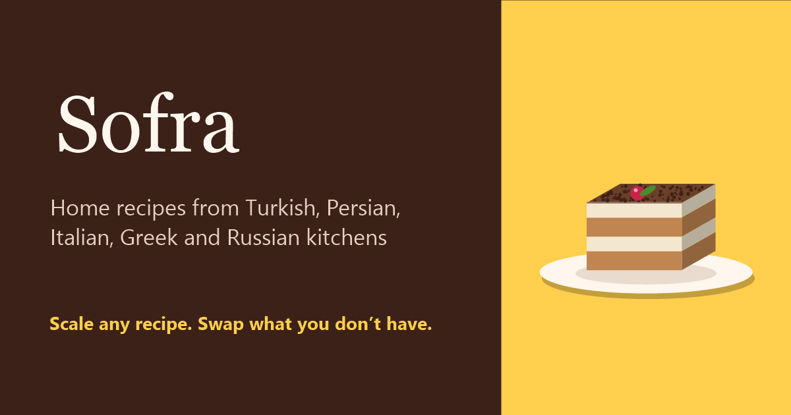

# Sofra



A recipe box of home cooking from Turkish, Persian, Italian, Greek, Russian & Ukrainian, Lebanese, Georgian, Azerbaijani and Balkan kitchens, plus a few bakes from further afield. 141 recipes, from breakfast and soups to meze, mains and desserts. In English or Turkish.

**Open it:** https://furkanork.github.io/Sofra/

## What it does

- **Browse** by cuisine and course, or search by dish or ingredient ("feta", "saffron", "tvorog"). Search ignores accents, so "kunefe" finds Künefe. **Surprise me** picks a random recipe.
- **Filter by diet:** vegetarian, vegan, gluten-free or 30 minutes or less. Worked out from the ingredients.
- **Scale** any recipe with − and +. Every amount recalculates.
- **Swap** an ingredient you don't have and get a substitute with the right amount.
- **Cook mode:** one step at a time in big text, swipe between steps, screen stays on. Steps that mention a time get a timer button, with an alarm.
- **What can I make?** Tick what's in your kitchen and see which recipes you can make, best matches first, including ones where a swap covers the gap.
- **Plan & shop:** add recipes to your week and get one shopping list with amounts added together, sorted by shop section, leaving out what's already in your pantry.
- **Notes and photos** on any recipe. A photo can become the recipe's cover.
- **Share** a recipe or your shopping list to WhatsApp, Messages and so on.
- **Measures:** grams and millilitres, US cups, or the Turkish su bardağı (200 ml).
- **Türkçe:** the whole interface in Turkish, with Turkish-kitchen recipes fully translated.
- **Backup and restore** everything you've added as a file, so a new phone starts where the old one left off.
- **Add your own recipes**, and it **works offline** once installed on your phone.

## Put it on your phone

**iPhone (Safari)**
1. Open https://furkanork.github.io/Sofra/ in Safari.
2. Tap the Share button, then **Add to Home Screen**.
3. Tap **Add**. Sofra opens full screen from its icon.

**Android (Chrome)**
1. Open https://furkanork.github.io/Sofra/ in Chrome.
2. Tap **Install app** when it's offered, or the ⋮ menu → **Add to Home screen** → **Install**.

Everything you add or save stays in that browser on that phone and doesn't sync between devices. Use **More → Backup** to save a file and restore it elsewhere.

Timers ring while Sofra is open on screen; phones pause web apps in the background.

## Files

| File | What it is |
|---|---|
| `index.html` | Page layout and dialogs |
| `styles.css` | All styling |
| `app.js` | App logic: list, recipe page, cook mode, timers, pantry, plan, backup, language, measures |
| `recipes.js` | All the recipe data |
| `recipes-tr.js` | Turkish recipe translations |
| `i18n.js` | Turkish interface text |
| `subs.js` | Ingredient swap suggestions |
| `pantry.js` | Pantry ingredients and shop sections |
| `draw.js` | The dish drawings |
| `diet.js` | Diet label rules |
| `tests/check.js` | Checks to run before publishing |
| `manifest.webmanifest` | App name, colours and icons for installing on a phone |
| `sw.js` | Service worker that keeps the app working offline |
| `icons/` | Home-screen icons and favicon |
| `og-image.png` | Preview image shown when the link is shared |

## Adding a recipe to the collection

Add an entry to `recipes.js`:

```js
{id:'my-dish', name:'My dish', local:'Also called…', origin:'Turkish', course:'mains',
 time:60, active:20, serves:4, unit:'servings', level:'Easy', tint:'#f6cfa2',
 art:{t:'bowl', b:'#ffffff', c:'#d9752e'},
 ing:['#Sauce', [2,'tbsp','olive oil'], [400,'g','chopped tomatoes'], [0,'','salt, to taste']],
 steps:['First step.', 'Second step.'],
 tip:'Optional tip.'},
```

- `course` is one of `breakfast`, `soups`, `meze`, `mains`, `pasta`, `bakes` or `desserts`.
- Each ingredient is `[amount, unit, name]`. Use an amount of `0` for "to taste". Units: `g`, `kg`, `ml`, `l`, `tsp`, `tbsp`, or `''` for a count.
- A string starting with `#` is a section heading.
- `art.t` picks the drawing: `slice`, `bowl`, `heap`, `pan`, `flat`, `dumpl`, `skewer`, `veg`, `stack`, `pastry`, `cookie`, `tray`, `dome`, `toast` or `loaf`. Copy the `art` of a similar dish to start.

To translate a recipe, add an entry to `recipes-tr.js` with `name`, `local`, and `ing` and `steps` arrays of the same length and order as the English (headings included).

After changing files, bump `VERSION` in `sw.js` and the `?v=` number on the file links in `index.html`, so installed phones pick up the update straight away.

## Checking changes

Before publishing, run:

```
node tests/check.js
```

It checks every recipe (fields, units, drawings), that Turkish translations line up with the English, that all interface text has Turkish, that every ingredient matches a pantry item, the swap suggestions, a set of known diet-label answers, and that the offline file list and version numbers agree. It prints what failed and exits with an error if anything does.

Diet labels (vegetarian, vegan, gluten-free) are worked out from ingredient names in `diet.js`. They are a best guess, and the app says so next to every label.

## Run it locally

It's plain static files with no build step. Serve the folder with any static server, for example:

```
npx serve .
```

Then open the address it prints.
